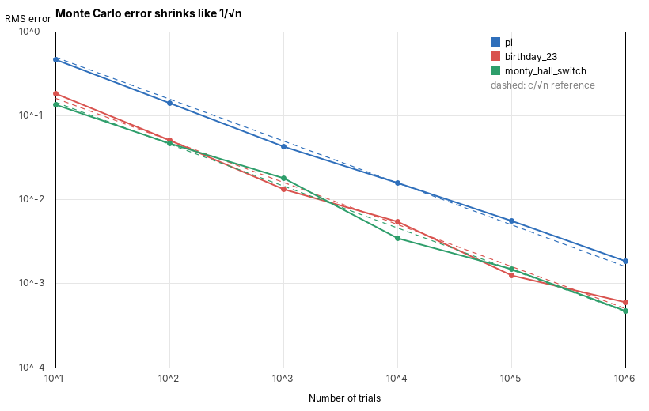

# Monte Carlo Estimation Lab (Java)

A command-line Java project that estimates quantities by random sampling and shows how the error shrinks as the number of trials grows. It covers three classic problems:

1. **Estimating π** by throwing random points at the unit square
2. **The Birthday Problem**: the chance that two people in a group share a birthday
3. **The Monty Hall problem**: whether switching doors wins more often

Results can be written as CSV or drawn as a log-log chart (PNG file or a Swing window). Plain Java 17+, no dependencies.

## Build and run

```bash
mkdir out
javac -d out src/montecarlo/*.java

java -cp out montecarlo.Main pi --trials 5000000
java -cp out montecarlo.Main birthday --people 23
java -cp out montecarlo.Main monty
java -cp out montecarlo.Main study --csv results.csv --png chart.png
java -cp out montecarlo.Main study --chart        # opens a Swing window
```

| Option | Meaning | Default |
|---|---|---|
| `--trials N` | Trials for a single run | 1000000 |
| `--seed S` | Random seed (same seed, same results) | 42 |
| `--people K` | Group size for the birthday problem | 23 |
| `--runs R` | Repeats per size in `study` | 20 |
| `--max-exp E` | `study` uses 10, 100, ... 10^E trials | 6 |
| `--csv FILE` | Write study results as CSV | `results.csv` if no output option given |
| `--png FILE` | Save the chart as PNG (works without a display) | |
| `--chart` | Show the chart in a Swing window | |

## The three experiments

**π.** A random point (x, y) in the unit square lands inside the quarter circle when x² + y² ≤ 1. That happens with probability π/4, so π ≈ 4 × (hits / trials).

**Birthday problem.** Each trial draws `k` random birthdays from 365 days and checks for a repeat. The exact answer is 1 − (365/365)(364/365)···((365−k+1)/365), which gives 0.5073 for k = 23. The simulation is compared against it.

**Monty Hall.** Each trial hides a car behind one of three doors, picks a door, has the host open a goat door that is neither the pick nor the car, then either stays or switches. The simulation plays the game literally rather than assuming the answer. Switching wins with probability 2/3, staying with 1/3.

## How the error shrinks

Every estimate here is an average of independent trials, so the standard deviation of the estimate is σ/√n, where σ is the standard deviation of a single trial. Ten times more trials buys only about 3.16 times less error, and each extra digit of accuracy costs 100 times the work.

For a yes/no trial with success probability p, σ = √(p(1−p)). The study reports **RMS error × √n**, which should settle near a constant:

| Experiment | Predicted constant | Formula |
|---|---|---|
| π (scaled by 4) | 1.64 | 4·√((π/4)(1−π/4)) |
| Birthday, k = 23 | 0.50 | √(0.5073 × 0.4927) |
| Monty Hall, switch | 0.47 | √((2/3)(1/3)) |

### Sample results

One run of `study` (seed 42, 20 repeats per size) printed these figures. Regenerate them with the command above; the files are in `sample/`.

| n | π RMS error | Birthday RMS error | Monty Hall RMS error |
|---|---|---|---|
| 10 | 0.4648 | 0.1806 | 0.1352 |
| 100 | 0.1419 | 0.0513 | 0.0464 |
| 1,000 | 0.0429 | 0.0133 | 0.0180 |
| 10,000 | 0.0158 | 0.0055 | 0.0034 |
| 100,000 | 0.0056 | 0.0013 | 0.0015 |
| 1,000,000 | 0.0019 | 0.0006 | 0.0005 |



Each curve falls with slope close to −1/2 on the log-log plot, parallel to its dashed c/√n reference. The RMS error × √n column in `results.csv` stays near the predicted constants (about 1.4 to 1.9 for π, 0.4 to 0.6 for the other two). It wobbles because each size is only 20 repeats; raise `--runs` to smooth it.

## Project layout

```
src/montecarlo/
  Main.java              command-line interface
  PiEstimator.java       π by random sampling
  BirthdayProblem.java   simulation and exact formula
  MontyHall.java         the game played trial by trial
  ConvergenceStudy.java  repeats each experiment at growing sizes, writes CSV
  Chart.java             log-log chart (BufferedImage, optional Swing window)
  Experiment.java        interface: (trials, random source) -> estimate
  Target.java            an experiment plus its exact answer
sample/                  example CSV and chart
```

Adding an experiment means writing a function with the `Experiment` signature and adding one `Target` in `Main`.

## Design notes

- `SplittableRandom` is fast and seedable. The study hands each repeat its own `split()` stream, so a given seed reproduces the exact same numbers.
- The birthday simulation stamps each day with the trial number instead of clearing an array every trial.
- Chart rendering draws to a `BufferedImage`, so `--png` works on a server with no display, and `--chart` just shows that image in a window.

## Ideas to extend

- Estimate an integral (for example ∫₀¹ eˣ dx) and compare uniform sampling with importance sampling
- Add a confidence-interval column (estimate ± 1.96·σ/√n)
- Run repeats in parallel with `parallelStream()` and `SplittableRandom.split()`
- Try variance reduction for π, such as antithetic or stratified sampling, and plot the improvement
- Add the n-door Monty Hall variant
